<picture>
  <source media="(prefers-color-scheme: dark)" srcset="./assets/pacman-hero-dark.svg">
  
</picture>

<b>cratos117</b>

**Player 1.** 💻 Sobre mí
* 🔭 Actualmente estoy desarrollando herramientas web y software personalizado para gestión clínica, además de plataformas interactivas.
* ⚡ Me apasiona el hardware IoT (ESP32, LoRa/Meshtastic), la electrónica, la reparación de equipos y la automatización.
* 🛠️ Tecnologías principales: **Python, JavaScript, HTML/CSS, Git, Linux**.

#### Scoreboard

<picture>
  <source media="(prefers-color-scheme: dark)" srcset="./assets/pacman-score-dark.svg">
  
</picture>

How to read the board

- **The maze is your year:** one column per week of the last 12 months and one row per weekday (Sunday on top), like the contribution calendar. Every day is a pellet, bigger and brighter on busier days; a faint dot is a day off.
- **Power pellets** are your busiest days. In the demo, the chomper eats its way to one of them and powers up.
- **The ghosts** are your featured repos, one each. Once it's powered up, the chomper eats them, and each one pops its stars before floating home to the pen.
- **The walls** are generated from your username and mirrored like an arcade board, so every board is different. The tunnel on Wednesdays wraps around.
- **HUD:** the score is your contributions over the year, alongside your best day, your longest streak, and your level: years on GitHub.
- **High scores** are your numbers, ranked the way an arcade ranks them. **Bonus items** are your languages by share of code.

Artwork: original animated SVG, generated by README Templates · template: Pacman. Motion stops if your system asks for reduced motion.

#### The ghosts

- **[cratos117.github.io](https://github.com/cratos117/cratos117.github.io)** · cifrador Alejandro  
  CSS
- **[sistema-de-registro](https://github.com/cratos117/sistema-de-registro)**  
  HTML

**Power-ups:** CSS · JavaScript · HTML

<picture>
  <source media="(prefers-color-scheme: dark)" srcset="./assets/pacman-end-dark.svg">
  
</picture>

